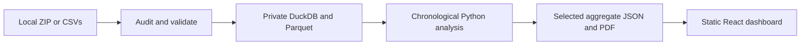

<div align="center">

# Royals' Resolve

### Find the nerve. Back the talent.

**An independent SupeRR Selector research entry for Rajasthan Royals' IPL 2027 auction**

[Run locally](#run-the-dashboard-locally) · [Rebuild the analysis](#rebuild-the-analysis) · [Methodology](docs/methodology.md) · [Deployment](docs/deployment.md)

</div>

> This is an independent competition entry, not an official Rajasthan Royals product.

## Run the dashboard locally

The repository includes the generated analysis and report. To run them without rerunning the Python pipeline, open PowerShell at the repository root and run:

```powershell
npm --prefix frontend ci
npm --prefix frontend run build

$env:STATIC_ROOT = (Resolve-Path frontend/dist).Path
$env:PORT = '8080'
node deploy/server.mjs
```

Then open **http://localhost:8080**. Keep that terminal open while using the dashboard; press **Ctrl+C** to stop the local server.

For a development server with hot reload, use a second terminal:

```powershell
npm --prefix frontend run dev
```

Vite prints the local address. The data is served from saved results; the browser does not train models.

## Rebuild the analysis

Use **Python 3.10** and **Node.js 24**. The exact Python dependency versions are pinned in `analysis/requirements.lock.txt`; frontend dependencies are pinned in `frontend/package-lock.json`.

1. Put the supplied ZIP at `data/incoming/pack.zip`. This folder is ignored by Git. The supplied pack is not included in the repository.
2. From the repository root, install Python dependencies and audit the pack:

```powershell
python -m venv .venv
.venv\Scripts\python -m pip install -r analysis/requirements.lock.txt
.venv\Scripts\python analysis/audit.py --input-zip data/incoming/pack.zip
```

You can instead pass `--input-zip PATH` or `--input-dir PATH` to a directory containing the six CSVs. The audit rejects unsafe archive paths and symlinks, limits nested archives to three levels and 512 MiB expanded data, and fails if required inputs are missing.

3. Run the chronological analysis and create the report:

```powershell
.venv\Scripts\python analysis/pipeline.py
.venv\Scripts\python analysis/report.py
```

4. Rebuild and serve the dashboard:

```powershell
npm --prefix frontend ci
npm --prefix frontend run build
$env:STATIC_ROOT = (Resolve-Path frontend/dist).Path
$env:PORT = '8080'
node deploy/server.mjs
```

The report command writes the publication-safe analysis JSON and matching PDF under `results/public/`, then copies them into the frontend build inputs. The Vite build packages those saved results into `frontend/dist/`.

## What the project does



The dashboard provides the two ordered top-ten lists, a Top Picks landing section, player score audits, role and matchup evidence, raw-stat comparisons, backtests, RR coverage context, and candidate comparisons. The source data stays local; only selected aggregates are included in the public results and static build.

### Repository map

| Location | Contents |
| --- | --- |
| `analysis/audit.py` | Input safety, hashes, schemas, relational checks, private DuckDB/Parquet |
| `analysis/pipeline.py` | Delivery reconstruction, chronological models, pressure labels, player aggregates |
| `analysis/supporting.py` | Coach metrics, match-cluster comparisons, selection backtests |
| `analysis/decision_views.py` | Matchup summaries and private local pressure-passage replay |
| `analysis/report.py` | PDF generation from the same saved analysis as the dashboard |
| `analysis/tests/` | Synthetic contracts and real-export consistency checks |
| `config/` | Method settings and public-source provenance |
| `docs/methodology.md` | Definitions, equations, exclusions, assumptions and limits |
| `results/public/` | Publication-safe aggregate JSON and methodology PDF |
| `frontend/` | React, TypeScript and Vite dashboard |
| `deploy/` | Static HTTP server and deployment checks |
| `artifacts/private/` | Local audit tables, exclusions, replay and PDF review images; never publish |

## Current data and findings

The supplied pack contains **200,999 deliveries across 883 matches**, dated 2022-01-22 through 2026-11-01. It includes all six required CSVs and the competition brief. The pack does not identify its upstream provider, so this project does not label it Cricsheet.

The conservative audit retains **80,902 events in 345 matches and 690 innings**. It excludes **120,097 events in 538 matches and 1,034 innings**; exclusion reasons overlap. Ambiguous `Overstep` and `other` extras affect 486 matches and create substantial coverage bias. Revised-target timing, incomplete innings, super overs, ties and result-reconciliation failures are also handled explicitly. Impact-player appearances remain separate player IDs with their observed delivery exposure.

The strict room-for-error method leaves one eligible batter at the declared minimum of 30 pressure events across five matches, so it cannot support a batting top ten. The current provisional lists use the documented phase/required-rate fallback for both roles: 116 eligible batters and 132 bowlers. The fallback is not presented as a validated superior pressure measure. Rankings use contextual run residuals; wicket value is shown separately and is not added as an unvalidated bonus.

Chronological task-viability Brier scores for 2023–2026 are approximately 0.127, 0.148, 0.134 and 0.135. These assess task outcome calibration, not psychological pressure accuracy. Later-season selection checks are mixed and do not establish uniform superiority. Full results and caveats are in the dashboard and PDF.

## Verify the outputs

To run the repository checks after rebuilding:

```powershell
.venv\Scripts\python -m unittest discover -s analysis/tests -v
.venv\Scripts\python analysis/check_publication.py
node deploy/check-static.mjs http://127.0.0.1:8080
```

The static check expects the local server to be running. The analysis check confirms the publication allowlist and checks for source maps or source records in the build.

## Deployment

The project includes a Dockerfile and Cloud Build configuration for manual Cloud Run deployment. Docker execution and cloud deployment were not verified in this environment. Follow [the deployment guide](docs/deployment.md); set your own Google Cloud project, region, Artifact Registry repository, and service accounts. No live deployment URL is claimed.

Interactive desktop and mobile browser checks also remain unverified because the local browser tool could not access the preview. The static production build, report output, and local HTTP routes were checked.
