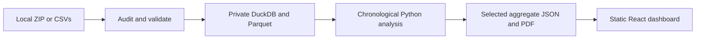

<div align="center">

# Royals' Resolve

### Find the nerve. Back the talent.

**An independent SupeRR Selector research entry for Rajasthan Royals' IPL 2027 auction**

[Run locally](#run-the-dashboard-locally) · [Rebuild the analysis](#rebuild-the-analysis) · [Methodology](docs/methodology.md) · [Deployment](docs/deployment.md)

</div>

> This is an independent competition entry, not an official Rajasthan Royals product.

## Run the dashboard locally

The repository includes the generated analysis and report. To run them without rerunning the Python pipeline, open PowerShell at the repository root and run:

```powershell
npm --prefix frontend ci
npm --prefix frontend run build

$env:STATIC_ROOT = (Resolve-Path frontend/dist).Path
$env:PORT = '8080'
node deploy/server.mjs
```

Then open **http://localhost:8080**. Keep that terminal open while using the dashboard; press **Ctrl+C** to stop the local server.

For a development server with hot reload, use a second terminal:

```powershell
npm --prefix frontend run dev
```

Vite prints the local address. The data is served from saved results; the browser does not train models.

## Rebuild the analysis

Use **Python 3.10** and **Node.js 24**. The exact Python dependency versions are pinned in `analysis/requirements.lock.txt`; frontend dependencies are pinned in `frontend/package-lock.json`.

1. Put the supplied ZIP at `data/incoming/pack.zip`. This folder is ignored by Git. The supplied pack is not included in the repository.
2. From the repository root, install Python dependencies and audit the pack:

```powershell
python -m venv .venv
.venv\Scripts\python -m pip install -r analysis/requirements.lock.txt
.venv\Scripts\python analysis/audit.py --input-zip data/incoming/pack.zip
```

You can instead pass `--input-zip PATH` or `--input-dir PATH` to a directory containing the six CSVs. The audit rejects unsafe archive paths and symlinks, limits nested archives to three levels and 512 MiB expanded data, and fails if required inputs are missing.

3. Run the chronological analysis and create the report:

```powershell
.venv\Scripts\python analysis/pipeline.py
.venv\Scripts\python analysis/report.py
```

4. Rebuild and serve the dashboard:

```powershell
npm --prefix frontend ci
npm --prefix frontend run build
$env:STATIC_ROOT = (Resolve-Path frontend/dist).Path
$env:PORT = '8080'
node deploy/server.mjs
```

The report command writes the publication-safe analysis JSON and matching PDF under `results/public/`, then copies them into the frontend build inputs. The Vite build packages those saved results into `frontend/dist/`.

## What the project does



The dashboard provides top-ten, top-twenty and all-eligible ranking filters, a side-by-side player scorecard, player score audits, role and matchup evidence, raw-stat comparisons, backtests and verified RR coverage context. The source delivery files stay local; the public results include only eligible-player aggregates and the analysis outputs needed by the dashboard.

### Repository map

| Location | Contents |
| --- | --- |
| `analysis/audit.py` | Input safety, hashes, schemas, relational checks, private DuckDB/Parquet |
| `analysis/pipeline.py` | Delivery reconstruction, chronological models, pressure labels, player aggregates |
| `analysis/supporting.py` | Coach metrics, match-cluster comparisons, selection backtests |
| `analysis/decision_views.py` | Matchup summaries and private local pressure-passage replay |
| `analysis/report.py` | PDF generation from the same saved analysis as the dashboard |
| `analysis/tests/` | Synthetic contracts and real-export consistency checks |
| `config/` | Method settings and public-source provenance |
| `docs/methodology.md` | Definitions, equations, exclusions, assumptions and limits |
| `results/public/` | Publication-safe aggregate JSON and methodology PDF |
| `frontend/` | React, TypeScript and Vite dashboard |
| `deploy/` | Static HTTP server and deployment checks |
| `artifacts/private/` | Local audit tables, exclusions, replay and PDF review images; never publish |

## Current data and findings

The supplied pack contains **200,999 deliveries across 883 matches**, dated 2022-01-22 through 2026-11-01. The Round 1 brief specifies IPL and T20I: the ranking includes **194,014 deliveries across 837 IPL/T20I matches** and excludes 6,985 deliveries from other T20 competitions in the pack. The pack does not identify its upstream provider, so this project does not label it Cricsheet.

Data-quality checks retain **77,141 IPL/T20I deliveries across 328 matches**. A further 116,873 in-scope deliveries across 509 matches are excluded under conservative rules; exclusion reasons overlap. Ambiguous `Overstep` and `other` extras are the largest exclusion and create substantial coverage bias. Revised-target timing, incomplete innings, super overs, ties and result-reconciliation failures are also handled explicitly. Impact-player appearances remain separate player IDs with their observed delivery exposure.

The strict margin pressure definition supports only 2 batters and 57 bowlers for this scope, so the rankings use the documented phase and required-rate fallback for both roles. The score ranks the **smoothed pressure lift over each player's own non-pressure contextual run contribution**, with a 95% match-bootstrap interval. Eligibility requires 30 pressure deliveries across five matches plus 60 non-pressure deliveries across five matches; for each format in the pressure sample, the ordinary baseline must also include 30 deliveries across three matches. Other T20 competitions are excluded from candidate scores. T20I-only evidence can qualify under the brief, but it does not establish IPL auction eligibility or availability.

The model predicts expected runs using earlier seasons only. 2026 task-model validation is a later-match check, not a prospective test of player rankings or psychological pressure. Venue and opponent effects, wicket value and 2027 auction status are not established. See the methodology report for the pressure definition, equations, top-ten evidence and limitations.

## Verify the outputs

To run the repository checks after rebuilding:

```powershell
.venv\Scripts\python -m unittest discover -s analysis/tests -v
.venv\Scripts\python analysis/check_publication.py
node deploy/check-static.mjs http://127.0.0.1:8080
```

The static check expects the local server to be running. The analysis check confirms the publication allowlist and checks for source maps or source records in the build.

## Deployment

The project includes a Dockerfile and Cloud Build configuration for manual Cloud Run deployment. Docker execution and cloud deployment were not verified in this environment. Follow [the deployment guide](docs/deployment.md); set your own Google Cloud project, region, Artifact Registry repository, and service accounts. No live deployment URL is claimed.

Interactive desktop and mobile browser checks also remain unverified because the local browser tool could not access the preview. The static production build, report output, and local HTTP routes were checked.
